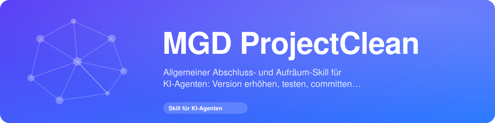

<!-- MGD-HEADER -->
<p align="center"><a href="https://Michael-Gahn.de"></a></p>

<p align="center"></p>

<p align="center">
  
  <a href="https://github.com/MichaelGahnDESIGN/MGD_ProjectClean_SKILL/releases/latest"></a>
  <a href="https://Michael-Gahn.de"></a>
</p>
<!-- /MGD-HEADER -->

# ProjectClean-Skill

Ein allgemeiner Abschluss- und Aufräum-Skill für KI-Agenten.

Der Skill führt ein Projekt durch einen kontrollierten Abschluss-Workflow: Versionsnummer erhöhen, testen, committen, pushen, Dokumentation aktualisieren, lokales Backup erstellen, alte Backups löschen und den Projektordner aufräumen.

Er ist bewusst projektneutral gehalten und funktioniert mit beliebigen Stacks, Versionsdateien, Testbefehlen und Dokumentationsstrukturen.

## Für wen ist das gedacht?

Für Menschen, die mit KI-Agenten entwickeln und am Ende eines Arbeitsstands einen sauberen, dokumentierten und gesicherten Zustand herstellen wollen – ohne jeden Schritt manuell aufzählen zu müssen.

Der Skill ist besonders hilfreich, wenn:

- eine neue Version veröffentlicht werden soll,
- ein Projekt übergeben oder pausiert wird,
- Speicherplatz gespart werden soll,
- das lokale Backup-Archiv bereinigt werden soll,
- die Projektdokumentation nach einer Änderungsrunde aktualisiert werden soll.

## Schnellstart

```bash
# Claude Code
git clone https://github.com/MichaelGahnDESIGN/MGD_ProjectClean_SKILL.git ~/.claude/skills/projectclean

# ChatGPT Codex
git clone https://github.com/MichaelGahnDESIGN/MGD_ProjectClean_SKILL.git ~/.codex/skills/projectclean
```

Danach in einem beliebigen Projekt:

```text
/projectclean
```

Oder gezielt einzelne Schritte:

```text
/projectclean
Erhöhe nur die Version, teste und committe. Backup und Cleanup später.
```

## Ablauf

Der Skill führt den Agenten durch neun Bereiche:

1. **Projektkontext laden** – Regeln, Stack, Versionsdateien, Testbefehle, Git-Stand.
2. **Versionsnummer erhöhen** – alle zuständigen Dateien synchron aktualisieren.
3. **Tests ausführen** – projektspezifische Testbefehle; bei Fehlern stoppen und fragen.
4. **Committen** – nur relevante Dateien, aussagekräftige Commit-Nachricht.
5. **Pushen** – kein Force-Push ohne Freigabe, Konflikte nicht blind lösen.
6. **Dokumentation aktualisieren** – CHANGELOG, Versionen, Deployment, README-Badges; detailliert.
7. **Lokales Backup erstellen** – mit Hashmanifest, Datum und Versionsnummer im Dateinamen.
8. **Ältere Backups löschen** – mindestens 3 vollständige Backups je Familie behalten.
9. **Ordner aufräumen** – `node_modules`, Build-Artefakte, Caches, Logs; Speicherplatz-Bericht.

Die Reihenfolge ist wichtig: Backup vor Cleanup, Tests vor Commit.

## Versionsdateien

Der Skill erkennt und aktualisiert automatisch:

| Stack | Datei |
| --- | --- |
| Node.js / TypeScript | `package.json` |
| Python | `pyproject.toml`, `setup.py` |
| Flutter / Dart | `pubspec.yaml` |
| Rust | `Cargo.toml` |
| Allgemein | `VERSION` |

Wenn mehrere Dateien vorhanden sind, werden alle synchron aktualisiert.

## Sicherheitsprinzipien

- Erst sichern, dann löschen.
- Erst testen, dann committen.
- Keine Secrets, `.env`-Dateien oder personenbezogenen Daten in Git, Backups oder Dokumentation.
- Mindestens 3 vollständige Backups je Familie erhalten.
- Keine Force-Pushes und keine produktiven Nebenwirkungen ohne Freigabe.
- Unbekannte Dateien lieber einmal zu viel fragen als einmal zu schnell löschen.

## Slash-Command-Vorlagen

```text
.claude/commands/projectclean.md
.codex/commands/projectclean.md
```

Diese Dateien sorgen dafür, dass `/projectclean` in Claude Code und ChatGPT Codex als direkter Befehl erkannt wird.

## Repository-Struktur

```text
ProjectClean-Skill/
├── SKILL.md
├── README.md
├── LICENSE
├── .gitignore
├── .claude/
│   └── commands/
│       └── projectclean.md
└── .codex/
    └── commands/
        └── projectclean.md
```

## Updates

```bash
# Claude Code
cd ~/.claude/skills/projectclean && git pull

# ChatGPT Codex
cd ~/.codex/skills/projectclean && git pull
```

## Verwandte Projekte Von Michael Gahn DESIGN

ProjectClean gehört zu einer kleinen Werkzeugfamilie für KI-gestützte
Projektarbeit.

- [AI-Basic-Projektordner](https://github.com/MichaelGahnDESIGN/MGD_AI-Basic-Projektordner_TOOL)  
  Eine saubere Projektvorlage mit Regeln, Dokumentation, Agentenstruktur und
  Sicherheitsgrenzen. Sinnvoll als Basis für neue Projekte.

- [AI Project Updater Skill](https://github.com/MichaelGahnDESIGN/MGD_AI-Project-Updater_SKILL)  
  Ein geführter Assistent für lokale Staging-Umgebungen, Docker-Planung,
  Update-Vorbereitung und sichere Staging-zu-Live-Abläufe. Das Repository ist
  während der Entwicklung zunächst privat.

- [DEV-Skill](https://github.com/MichaelGahnDESIGN/MGD_DEV_SKILL)  
  Ein projektneutraler Skill für Projekt-Sync, Tests, GitHub-Abgleich,
  Deploy-Vorbereitung, Backups und Abschlussberichte.

- [AI-PlayTest-Skill](https://github.com/MichaelGahnDESIGN/MGD_AI-PlayTest_SKILL)  
  Ein Skill für Play-Tests aus Sicht echter Nutzerrollen, lokal, auf Staging
  oder vorsichtig auf Live.

- [Claude-Codex-MCP](https://github.com/MichaelGahnDESIGN/MGD_Claude-Codex_MCP)  
  Ein lokales MCP-System für Aufgaben, Chat und Übergaben zwischen Claude,
  Codex und weiteren KI-Agenten.

<!-- MGD-RELATED:START -->
## Skill-Empfehlungen

Passt gut dazu:

| Skill | Befehl | Wofür |
|---|---|---|
| [MGD_DEV_SKILL](https://github.com/MichaelGahnDESIGN/MGD_DEV_SKILL) | `/dev` | Release, Sync, Backup, Cleanup, Tests und Wissensdokumentation |
| [MGD_Backup_SKILL](https://github.com/MichaelGahnDESIGN/MGD_Backup_SKILL) | `/backup` | Backups lokal, NAS und Cloud mit Prüfsummen |
| [MGD_Todo_SKILL](https://github.com/MichaelGahnDESIGN/MGD_Todo_SKILL) | `/todo` | Aufgabenliste in einer HTML-Datei, dazu /board, /wissen, /fragenkatalog, /prozesse |

## Verwandte MGD Projekte

<details><summary>Alle MGD-Skills und Werkzeuge anzeigen</summary>

| Projekt | Befehl | Wofür |
|---|---|---|
| [MGD_Todo_SKILL](https://github.com/MichaelGahnDESIGN/MGD_Todo_SKILL) | `/todo` | Aufgabenliste in einer HTML-Datei, dazu /board, /wissen, /fragenkatalog, /prozesse |
| [MGD_DEV_SKILL](https://github.com/MichaelGahnDESIGN/MGD_DEV_SKILL) | `/dev` | Release, Sync, Backup, Cleanup, Tests und Wissensdokumentation |
| [MGD_Autopilot_SKILL](https://github.com/MichaelGahnDESIGN/MGD_Autopilot_SKILL) | `/autopilot` | Projektziele sicher unbeaufsichtigt abarbeiten |
| [MGD_Backup_SKILL](https://github.com/MichaelGahnDESIGN/MGD_Backup_SKILL) | `/backup` | Backups lokal, NAS und Cloud mit Prüfsummen |
| [MGD_AI-Thread](https://github.com/MichaelGahnDESIGN/MGD_AI-Thread) | `/thread` | Ehrliche Übergabe, bevor das Kontextfenster voll ist |
| [MGD_Living-Documentation](https://github.com/MichaelGahnDESIGN/MGD_Living-Documentation) | `/doku` | Lebendige Dokumentation: keine Entscheidung geht verloren |
| [MGD_BugReport_SKILL](https://github.com/MichaelGahnDESIGN/MGD_BugReport_SKILL) | `/bugreport` | Handbuch für Bug-Reports, Feedback und QA in Apps |
| [MGD_AI-PlayTest_SKILL](https://github.com/MichaelGahnDESIGN/MGD_AI-PlayTest_SKILL) | `/playtest` | Test aus Nutzerperspektive für KI-gebaute Funktionen |
| [MGD_AI-Testaccount_SKILL](https://github.com/MichaelGahnDESIGN/MGD_AI-Testaccount_SKILL) | `/testaccount` | Testkonten per Plus-Adresse mit klaren Sicherheitsregeln |
| [MGD_Software-Updater_SKILL](https://github.com/MichaelGahnDESIGN/MGD_Software-Updater_SKILL) | `/software-updater` | Update-Systeme planen und umsetzen |
| [MGD_Divi5-Dev_SKILL](https://github.com/MichaelGahnDESIGN/MGD_Divi5-Dev_SKILL) | `/divi` | WordPress und Divi 5: Animationen, Plugins, Child-Themes |
| [MGD_JTL-OPC_SKILL](https://github.com/MichaelGahnDESIGN/MGD_JTL-OPC_SKILL) | `/jtl-opc` | JTL-Shop-5-Seiten im OnPage Composer automatisch befüllen |
| [MGD-SEO](https://github.com/MichaelGahnDESIGN/MGD-SEO) | `/seo` | SEO-Skill mit lokalem Prüfkern |
| [MGD-Motion-Graphics-Video-Skill](https://github.com/MichaelGahnDESIGN/MGD-Motion-Graphics-Video-Skill) | `/mgd-video` | Reels, YouTube, Werbefilme und Animationen |
| [MGD-Foundry-VTT_Skill](https://github.com/MichaelGahnDESIGN/MGD-Foundry-VTT_Skill) | `/vttl-notizbuch` | Foundry VTT und D&D-Notizbücher |
| [MGD_AI-Basic-Projektordner_TOOL](https://github.com/MichaelGahnDESIGN/MGD_AI-Basic-Projektordner_TOOL) | `Vorlage` | Projektordner für ChatGPT Codex, Cowork und Claude Code |
| [MGD_Docker_Projektbuilder](https://github.com/MichaelGahnDESIGN/MGD_Docker_Projektbuilder) | `Generator` | Docker-Plattform-Gerüste aus sechs Fragen |
| [MGD_Claude-Codex_MCP](https://github.com/MichaelGahnDESIGN/MGD_Claude-Codex_MCP) | `MCP` | Lokales MCP für Aufgaben, Chat und Übergaben zwischen KI-Agenten |

</details>

Mit `/skill-update` (im Todo-Skill) holst du alle lokal installierten MGD-Skills auf den neuesten Stand.
<!-- MGD-RELATED:END -->

## Lizenz

MIT Lizenz. Siehe [LICENSE](LICENSE).

## 🔒 Lokal-only — Playtests, Backups & sensible Daten

Diese Daten dürfen **niemals** die lokale Maschine verlassen — weder nach GitHub noch nach Live/Deploy:

- **Playtests:** Play-Test-Branches (`PlayTest*`) und -Artefakte (`PlayTest/`, Protokolle, Screenshots) bleiben lokal.
- **Backups:** DB-Dumps, `*.sql`, `*.sql.gz`, `BACKUPS/` bleiben lokal — nie nach GitHub, nie in den Webroot/Live.
- **Sensible Daten:** `.env*` (außer `.env.example`), Tokens, API-Keys, Passwörter, `*.pem`, `*.key`, Zugangsdaten — niemals committen/pushen/deployen.
- **Push-Disziplin:** Nur den Hauptbranch (`main`) pushen, **niemals** `git push --all`/`--mirror`. `PlayTest*`-Branches werden nie gepusht.

Alle genannten Muster gehören in `.gitignore`. Technische Absicherung: der Pre-Push-Hook aus dem [MGD_DEV_SKILL](https://github.com/MichaelGahnDESIGN/MGD_DEV_SKILL) (`dev/hooks/pre-push`) blockiert solche Pushes hart — empfohlen, am besten global via `git config --global core.hooksPath ~/.git-hooks`.

---

## Impressum

Angaben gemäß § 5 DDG — Siehe [`IMPRESSUM.md`](IMPRESSUM.md).

<!-- MGD-LEGAL -->
---

## Lizenz

Dieses Projekt steht unter der [MIT-Lizenz](https://opensource.org/license/mit). Den vollständigen Text enthält die Datei [LICENSE](LICENSE).

## Impressum

**Angaben gemäß § 5 DDG (Digitale-Dienste-Gesetz)**

Michael Gahn DESIGN  
Michael Gahn  
Dr.-Theodor-Brugsch Str. 12  
08529 Plauen  
Sachsen  
Deutschland

Tel.: +49 (0) 151 59156639  
E-Mail: Anfrage@Michael-Gahn.de

Umsatzsteuer-Identifikationsnummer gemäß § 27 a Umsatzsteuergesetz:  
Steuernummer: 223/222/02451  
Ust-ID: DE288143343

Wir sind zur Teilnahme an einem Streitbeilegungsverfahren vor einer Verbraucherschlichtungsstelle weder verpflichtet noch bereit.

**Redaktionell verantwortlich:**

Michael Gahn DESIGN  
Michael Gahn  
Dr.-Theodor-Brugsch Str. 12  
08529 Plauen  
Sachsen  
Deutschland

Tel.: +49 (0) 151 59156639  
E-Mail: Anfrage@Michael-Gahn.de
<!-- /MGD-LEGAL -->
